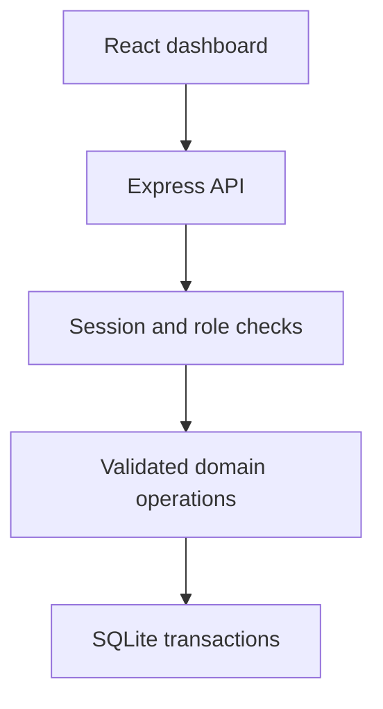

# AgentGuard

A policy and approval dashboard for simulated AI-agent tool calls.

Built with React, TypeScript, Express, Node.js 24 and SQLite. This is a working portfolio MVP, not a hosted production service.

## Run in three commands

Install **Node.js 24 or newer**, then open a terminal in this folder:

```sh
npm ci
npm run build
npm run demo
```

Open http://127.0.0.1:3000. Demo login:

- Administrator: `admin@demo.local`
- Read-only viewer: `viewer@demo.local`
- Password for both: `PortfolioDemo!2026`

These credentials are synthetic and intentionally public. Use demo mode only locally with synthetic data. Demo users are created only when the database is empty. Data persists in `data/app.sqlite` and is excluded from Git.

For development: `npm run dev` (Vite frontend on port 5173, API on 3000). For a second simultaneous project, set a different `PORT` when running the built app. In PowerShell: `$env:PORT="3001"; npm run demo`.

## Verification

```sh
npm run build
npm test
```

The test suite launches a real HTTP server with a fresh in-memory SQLite database per test. It checks authentication, protected writes, administrator/viewer roles and organization isolation, along with domain rules. `.github/workflows/ci.yml` runs the build and tests on push and pull request. A workflow file is included; a green GitHub CI run must be verified after publication.

## Architecture



- `web/`: responsive dashboard and typed API helper.
- `src/base.ts`: password hashing, expiring sessions, request protection and role checks.
- `src/app.ts`: domain routes and transactional persistence.
- `src/server.ts`: server entry point.
- `tests/`: HTTP integration tests.

SQLite makes the demo self-contained. Organization IDs scope each domain query; tests cover cross-organization access. There is no organization signup or team invitation UI yet. Single-process execution and synchronous SQLite transactions keep the prototype small; PostgreSQL and a durable queue are future work for distributed deployment.

## Non-demo startup

Copy `.env.example` to `.env`, set a unique administrator email and a password of at least 16 characters, and choose a fresh `DB_PATH`. Then run `npm start`. Bootstrap credentials are only used for an empty database; editing the environment does not change an existing account password.

For a public deployment, configure HTTPS at a reverse proxy, set `NODE_ENV=production` to require secure session cookies, persist the data volume, configure backups and review proxy/rate-limit configuration. The prototype has no password reset, MFA or account-management screens.

A Dockerfile is provided, but Docker execution was not verified in the build environment. It defaults to non-demo startup and needs `ADMIN_PASSWORD`. Avoid publishing the demo with known credentials.

## API conventions

All write requests need `Content-Type: application/json` and `X-Requested-With: portfolio-app`. Login sets an HttpOnly, SameSite=Strict cookie; other endpoints require that session. Mutations require the administrator role. API errors return `{"error":"..."}` and an appropriate HTTP status. The health endpoint is public.

| Method | Path | Purpose |
|---|---|---|
| POST | `/api/login` | Sign in with email/password |
| GET | `/api/me` | Current user and role |
| POST | `/api/logout` | Revoke the current session |
| GET | `/api/dashboard` | Organization-scoped workspace data |

## Implemented features

- Per-agent tool allowlist, lifetime demo-credit budget and rolling one-minute request limit.
- Server-defined operation cost: 1 credit for reading, 5 for a refund.
- Refunds over PKR 100 require explicit administrator approval.
- Pending approvals reserve budget; rejecting them releases that reservation.
- Request idempotency keys and exactly-once simulated execution records.
- Nested sensitive-key redaction and email-pattern masking before payload persistence.
- Audit timeline for policy decisions, approvals and execution.

| Method | Path | Purpose |
|---|---|---|
| POST | `/api/agents` | Name, tool allowlist, budget and rate limit |
| POST | `/api/requests` | Evaluate a tool request |
| POST | `/api/requests/:id/decision` | Approve or reject a pending request |
| POST | `/api/requests/:id/execute` | Execute an allowed/approved simulated tool |

### Example request

```json
{"agentId":"<agent UUID>","tool":"refund.issue","amount":25000,"requestKey":"<unique retry key>","payload":{"email":"customer@example.com"}}
```

Amounts are integer paisa: `25000` means PKR 250. Reuse the same request key and input for a retry. A different operational input returns 409. Payloads are compared after redaction; secrets discarded by redaction are not retained for comparison.

### Two-minute interview demo

1. Sign in and evaluate `database.delete`: it is denied.
2. Submit a PKR 250 refund: it waits for approval.
3. Approve and execute: a synthetic refund record appears.
4. Show the redacted customer email, audit timeline and reserved/used credits.
5. Explain the idempotency and budget tests.

### Boundaries

All tools are synthetic. No LLM, external agent framework or payment gateway is connected, and no money is moved. Credits are demo policy units, not measured provider charges. Redaction is heuristic and is not comprehensive DLP. The audit log is stored in the application database and is not cryptographically tamper-evident. The same administrator can submit and approve a request; independent approver separation is future work. Policies are set at agent creation; policy editing, service API keys, an SDK, streaming telemetry and prompt-injection detection are not implemented.

### CV description

Developed a TypeScript agent-control prototype with tool allowlists, approval gates, transactional budget reservations, redacted audit logs, and idempotent simulated execution.
